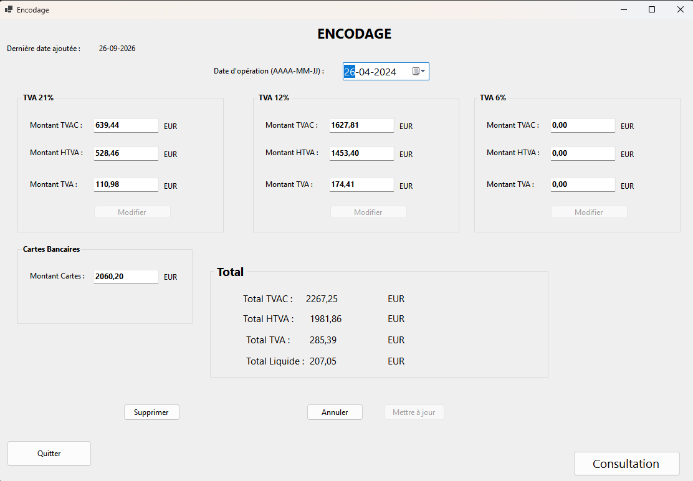
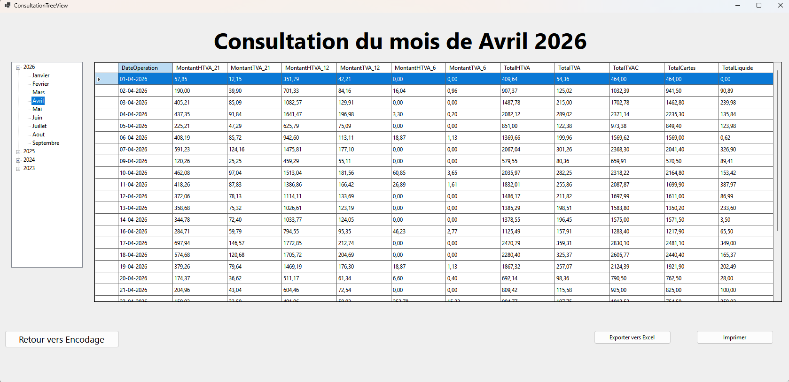

# 💶 Daily Revenue & Cash Management System

> **A .NET / C# Windows Forms desktop application designed for daily sales entry, multi-rate Belgian VAT calculation (6%, 12%, 21%), cash drawer reconciliation, and accounting reporting.**  
> *Independently developed (self-taught) prior to starting a Bachelor's Degree in Applied Computer Science, then deployed and operated in production for a local restaurant.*

---

## 📌 Context & Business Problem

In small business management, tracking daily revenue and breaking down Belgian VAT rates (6%, 12%, 21%) through manual spreadsheets frequently leads to rounding discrepancies, cash register imbalances, and significant time loss during monthly financial closures.

This software was built to address these operational challenges:
* **Streamline daily bookkeeping entries** by automating tax computations (excl. VAT bases, tax amounts, and register totals).
* **Simplify cash reconciliation** between electronic card payments and physical cash on hand.
* **Simplify accounting handoffs** with structured monthly Excel exports, printable closing reports, and hierarchical historical lookups.

---

## 📸 Interface Overview

### 1. Daily Entry & Cash Balancing (`Encodage.cs`)
* Dynamic tax breakdown across Belgian statutory rates (21%, 12%, 6%) with immediate recalculation of Gross, Net, and VAT amounts.
* Automatic physical cash balancing: $\text{Total Cash} = \text{Gross Total (TVAC)} - \text{Card Payments}$.
* Input validation, entry dates, and record editing/deletion with confirmation dialogs.



---

### 2. Historical Consultation & Financial Reporting (`ConsultationTreeView.cs`)
* Chronological tree navigation (`TreeView`) indexed by Year and Month.
* Consolidated data grid view (`DataGridView`) exposing full VAT sub-totals.
* Report printing (`DGVPrinter`) and export to Microsoft Excel (`ClosedXML`).



---

## 🛠️ Tech Stack

* **Language & Runtime:** C# (.NET 8.0 Desktop)
* **Graphical User Interface:** Windows Forms (WinForms)
* **Data Access & Persistence:** ADO.NET, Dapper, Microsoft.Data.SqlClient (SQL Server)
* **Document Generation:** ClosedXML (OpenXML standard / Excel exports)
* **Printing:** `DGVPrinter` component

---

## 📂 Source Code Architecture

```text
ApplicationRecette/
│
├── Forms/                         # Presentation Layer (WinForms UI)
│   ├── Encodage.cs                # Daily entry form & cash balance logic
│   ├── ConsultationTreeView.cs    # Chronological tree view & data grid navigation
│   ├── Consultation.cs            # Alternative tabular lookup
│   └── Avertissement.cs           # User dialogs & safety confirmations
│
├── DataAccess/                    # Persistence Layer (SQL Server / Dapper)
│   ├── DataAccess.cs              # Database connection management
│   ├── Inserts.cs                 # Daily revenue insertion routines
│   ├── SelectQuery.cs             # Filtering, aggregation & lookup queries
│   ├── Updates.cs                 # Modification routines for existing entries
│   └── Delete.cs                  # Safe record deletion routines
│
├── Model/                         # Data Models
│   ├── Recette.cs                 # Core entity representing a daily financial record
│   └── RecetteConsultation.cs     # Projection DTO for grid views
│
├── Calculs.cs                     # Financial math & rounding helpers
├── DateOperations.cs              # Calendar & date-formatting helpers
└── DGVPrinter.cs                  # Layout and printing engine for reports
```

## 🧠 Technical Retrospective & Post-Mortem

> This project was my first end-to-end software application deployed into real-world production. Built autonomously before formal university training, it successfully achieved its operational goals on the ground.  
> Looking back through the lens of software engineering principles acquired during my **Bachelor in Applied Computer Science (EPFC)**, here is my analysis of the initial design choices and how they would be redesigned today:

### 1. Database Modeling & Normalization
* **Initial Design:**  
  Data was stored in a single denormalized table (`Donnees`) with hard-coded columns per VAT rate (`MontantHTVA_21`, `MontantTVA_21`, `MontantHTVA_12`, etc.) and pre-calculated total fields.
* **Identified Drawbacks:**  
  * Lack of schema adaptability: any future tax reform or new tax rate would require database schema migrations (`ALTER TABLE`).
  * Risk of data anomalies when storing calculated totals without strict transactional enforcement.
* **How I would redesign it (Relational Design & Normalization):**  
  * Proper relational normalization: decoupling data into dedicated tables linked by foreign keys (`Recettes` 1 $\rightarrow$ N `LignesTVA` $\rightarrow$ `TauxTVA` reference table with validity dates).
  * On-the-fly total computation via SQL aggregations (`SUM`) or database views, avoiding redundant stored totals.


### 2. Software Architecture & OOP Best Practices
* **Initial Design:**  
  * **Broken Encapsulation & Shared State:** Critical application state and inter-form communication relied on mutable global static variables (`public static bool confirmation`, `public static Recette updatedRecette`), creating hidden dependencies and side effects.
  * **Procedural Approach:** Business calculations were placed in static procedural helper classes, while UI event handlers (`Button_Click`) handled data mutation and direct database calls.
* **How I would redesign it:**  
  * **OOP & Encapsulation:** Protecting object state with private fields, parameterized constructors, and domain methods to ensure models cannot exist in an invalid state.
  * **Multi-Tier Separation (MVVM):** Decoupling Presentation (WinForms UI) from Business Logic and Database persistence, removing direct dependencies between forms.
  * **Automated Unit Tests:** Testing encapsulated business logic, financial formulas, and cash reconciliation independently of the user interface.
  
### 3. Business Rules Validation & Data Integrity
* **Initial Design:**  
  Business rules, validation, and sanity checks were handled almost exclusively on the client side inside UI forms (e.g., input parsing, empty field checks, cash drawer balances calculated in button events).
* **How I would redesign it:**  
  * Moving core validation logic into backend services so data is checked before it reaches the database.
  * Enforcing database-level integrity using declarative constraints (`CHECK` constraints preventing negative amounts, `UNIQUE` index on transaction dates to forbid duplicate daily entries).
  * Implementing database **triggers** to enforce critical accounting rules automatically at the persistence level.

---
  
## 👤 Author

* **Aymen JERIDI** – Final-year student in Bachelor in Applied Computer Science (Application Development) at EPFC, Brussels

---

*Note: This repository is published as a portfolio case study and technical retrospective. All rights reserved.*
